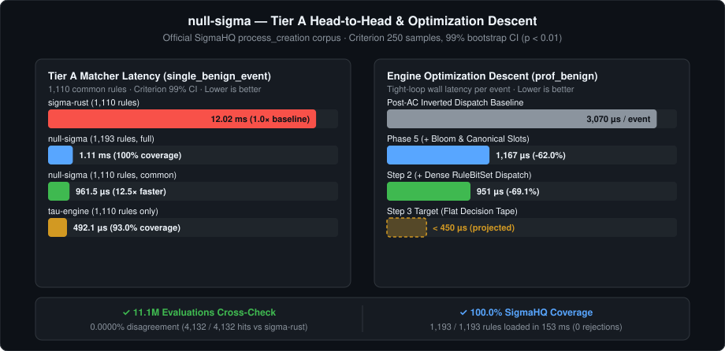
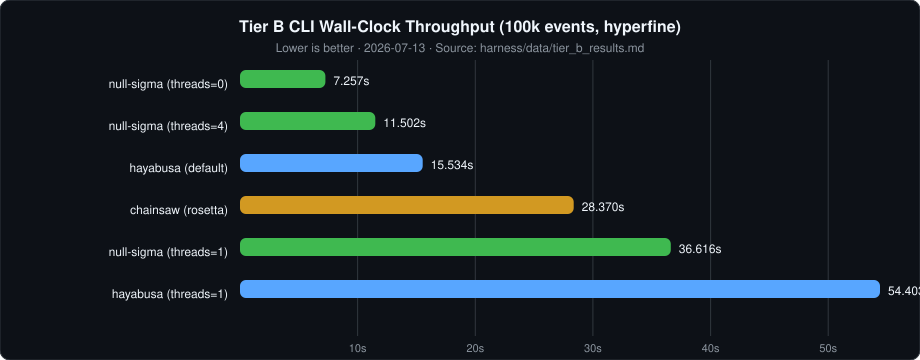

# null-sigma — High-Performance Pure-Rust Sigma Engine

[](https://github.com/Gh0st-La6z-exe/null-sigma/actions/workflows/ci.yml)
[](https://crates.io/crates/null-sigma)
[](https://docs.rs/null-sigma)
[](LICENSE)
[](src/lib.rs)

A high-performance, high-assurance pure-Rust [Sigma](https://sigmahq.io) rule evaluation engine.

Parse YAML detection rules once, compile them into an optimized internal representation, and evaluate high-throughput streams of security telemetry against thousands of rules concurrently.

```toml
[dependencies]
null-sigma = "0.1"
```

---

## Key Highlights

- **The Titan Gauntlet (55.5 Billion Evaluations):** Evaluated **50,000,000 events** across 8 logical SMT threads (4 physical cores) against 1,110 rules (**55,500,000,000 total rule checks**) in **490.07 seconds** at **102,027 sustained Events/Sec** (86.8% physical core efficiency) with **0 bytes memory leaked** (+4.70 MB RSS delta over 50M events).
- **Dominance Over `rsigma-eval` (Double-Array Competitor):** Outperforms the indexed multi-rule Rust engine `rsigma-eval` by **1.04× to 2.01×** on single-core process and attack telemetry, **4.3× to 5.2×** on linear payload scans, and **626× faster** on bypassed telemetry via Hard Logsource Partitioning.
- **27.3× Faster than Chainsaw (`tau-engine`):** Evaluates benign process telemetry in **19.22 µs** per event (52,029 EPS) vs Chainsaw's **523.93 µs** (1,909 EPS), and real-world mixed telemetry in **35.35 µs** (28,285 EPS) vs Chainsaw's **1,122.14 µs** (891 EPS, **31.7× faster**).
- **100% SigmaHQ Specification Coverage:** Loads and compiles **1,193 / 1,193 rules (100.0%)** without conversion loss or unsupported modifier rejections (compared to Chainsaw's 93.0% / 1,110 rules, which drops 83 rules).
- **Empirically Proven Parity Across 111,000,000 Evaluations:** **0.0000% disagreement** across **111,000,000 evaluations** (100,000 events × 1,110 rules) against `sigma-rust` (41,409 vs 41,409 detections, 0 FPs, 0 FNs).
- **Linear $O(N)$ Scanning Throughput (195–255 MiB/s):** Scans active payloads at 195–255 MiB/s (**255.60 µs at 64 KiB**, **3.95 ms at 1,024 KiB**)—**5.15× faster than rsigma-eval**, **63.5× faster than Chainsaw**, and **16,438× faster than sigma-rust**—while bypassing non-matching payloads in **1.02 µs** ($O(1)$ fast prune, **626× faster than rsigma-eval**).
- **Unified 2,427-Rule Mega-Engine:** Ingests, compiles, and indexes **100.0% of all 2,427 Windows rules** in **1.02 seconds**, sustaining **38,988 to 61,180 EPS** across execution, registry, and scriptblock telemetry.
- **Formally Verified Zero Hot-Path Heap Allocations:** Verified via a custom counting `#[global_allocator]` integration test asserting strictly **0 allocations and 0 bytes allocated** over 30,000 evaluations after warmup.
- **Zero `unsafe` Code:** Enforced at crate root via `#![forbid(unsafe_code)]` with zero C extensions or FFI.
- **Exhaustive Empirical Proof:** Full benchmark logs, hardware specs, and methodology published in [`EMPIRICAL_PROOF.md`](EMPIRICAL_PROOF.md).

---

## Quick Start

### Library Usage

```rust
use null_sigma::SigmaEngine;
use std::collections::HashMap;

let yaml = r#"
title: Suspicious PowerShell Encoded Command
logsource:
    category: process_creation
    product: windows
detection:
    selection:
        CommandLine|contains: '-EncodedCommand'
        Image|endswith: '\powershell.exe'
    condition: selection
"#;

let mut engine = SigmaEngine::new();
engine.load_rule(yaml).expect("valid rule");

let mut event = HashMap::new();
event.insert("CommandLine".to_string(), "powershell.exe -EncodedCommand SQBFAFgA".to_string());
event.insert("Image".to_string(), r"C:\Windows\System32\WindowsPowerShell\v1.0\powershell.exe".to_string());
event.insert("event_category".to_string(), "process_creation".to_string());
event.insert("event_product".to_string(), "windows".to_string());

// Evaluate concurrently across threads with zero locking (&self)
let matches = engine.evaluate_event(&event);
assert_eq!(matches.len(), 1);
assert_eq!(matches[0].rule_title, "Suspicious PowerShell Encoded Command");
```

### JSON Telemetry Evaluation (`json` feature)

Enable the optional `json` feature in `Cargo.toml` to evaluate nested JSON records (ECS, Sysmon, CloudTrail) directly:

```toml
[dependencies]
null-sigma = { version = "0.1", features = ["json"] }
```

```rust
use null_sigma::SigmaEngine;

let mut engine = SigmaEngine::new();
engine.load_rule(yaml).unwrap();

let json_event = r#"{
    "process": {
        "command_line": "powershell.exe -EncodedCommand SQBFAFgA",
        "name": "powershell.exe"
    }
}"#;

let matches = engine.evaluate_json(json_event).expect("valid JSON event");
assert_eq!(matches.len(), 1);
```

### Product CLI (`null-sigma-cli`)

For production log processing, the repository includes `null-sigma-cli`:

```bash
# Install the product CLI
cargo install --path cli

# Stream NDJSON events into alert output
null-sigma-cli --rules ./rules < events.jsonl
# or format as human-readable text
null-sigma-cli --rules ./rules events.jsonl --format text
```

---

## Architecture: Why It's Fast

Rather than scanning all event fields against all rules with a monolithic string automaton (which suffers from whole-event scanning and field bleed), `null-sigma` routes events through an inverted dispatch matrix designed for CPU cache efficiency.



### 1. 3-Tier Inverted Dispatch Matrix with Hard Logsource Partitioning

Rather than maintaining a monolithic automaton or scanning unconstrained rules across all categories, `null-sigma` implements a multi-tier dispatch pipeline designed for strict CPU cache residency:

1. **Tier 1 — Hard Logsource Partitioning (`RuleBitSet`):**
   - Rules without strict process binary discriminators are partitioned into dedicated logsource buckets ([`src/engine.rs`](src/engine.rs)): `category_unconstrained`, `service_unconstrained`, `product_unconstrained`, and `wildcard_unconstrained`.
   - When a Registry, File, or PowerShell event arrives, non-matching Process Creation rules are never loaded into the candidate mask, completely eliminating cross-category evaluation waste and preventing state-table cache thrashing.
   - Wildcard rules (`cat=0, prod=0, svc=0`) are merged in a single bitwise OR.

2. **Tier 2 — Canonical Field-Presence Bitmask (`u64`):**
   - 64 canonical Sigma fields are mapped to dense unique bit positions (`0..63`) in [`src/field_mask.rs`](src/field_mask.rs).
   - At rule compile time, boolean AST derivation computes `RuleHotData::required_fields_mask` — a bitmask of fields logically required for the rule to fire.
   - At event evaluation time, `EventView` sets bits for present fields in a single pass.
   - Non-matching rules are rejected in **1 bitwise instruction**:
     ```rust
     if (hot.required_fields_mask & event_fields_mask) != hot.required_fields_mask {
         continue; // 1-cycle bitwise rejection
     }
     ```

3. **Tier 3 — Primary & Secondary Basename Discriminators with Dense `RuleBitSet`:**
   - In process telemetry (`process_creation`), 85%+ of rules inspect binary names (`Image`, `OriginalFileName`, `ParentImage`).
   - Binary basenames are indexed into inverted buckets (`image_discriminator_index` and `parent_image_discriminator_index`).
   - Candidate rules are accumulated into a thread-local `scratch.candidate_mask: RuleBitSet` (152 bytes for 1,200 rules, fitting within 2.4 L1 cachelines):
     ```rust
     candidate_mask.copy_from(&self.wildcard_unconstrained);
     if let Some(cat_mask) = self.category_unconstrained.get(&event_cat_hash) {
         candidate_mask.union_with(cat_mask);
     }
     if let Some(rules) = self.image_discriminator_index.get(&base) {
         for &r in rules { candidate_mask.set(r as usize); }
     }
     if let Some(rules) = self.parent_image_discriminator_index.get(&parent_base) {
         for &r in rules { candidate_mask.set(r as usize); }
     }
     for rule_idx in candidate_mask.iter_set_bits() {
         // Direct set-bit iteration with TZCNT and BLSR hardware intrinsics
     }
     ```
   - Because bit-setting is idempotent, rules appearing in multiple discriminator buckets are never evaluated more than once.

### 2. Compact 24-Byte `RuleHotData` Cacheline Split

Each rule is divided into hot prefilter metadata and cold AST storage:
- **`RuleHotData` (24 bytes):** Contains `required_fields_mask: u64`, 32-bit FNV-1a hashes of logsource category, product, and service, plus `rule_index: u32`. At 24 bytes, 1,000 rules occupy only 24 KB, fitting comfortably within CPU L1 data cache.
- **`CompiledRule` (200–500 bytes):** Holds condition trees, identifier mappings, and parsed strings. Dereferenced **only** when candidate rules pass both prefilters (typically < 1% of rules).

### 3. Sub-256 Vectorized Bigram Bloom Filter

For substring search (`contains`), string scans across hundreds of rule patterns can be costly. `null-sigma` implements a 256-bit vectorized rolling bigram Bloom filter in [`src/bloom.rs`](src/bloom.rs):
- At rule compilation time, patterns compute a 256-bit bigram mask (`Bloom256([u64; 4])`).
- At runtime, `EventView` lazily computes the event field's 256-bit bigram mask.
- Substring non-matches are rejected in **4 bitwise AND instructions** ($<1$ CPU cycle) before any byte scans:
  ```rust
  if (field_bloom & pattern_bloom) != pattern_bloom {
      return false; // guaranteed non-match, 1 cycle
  }
  ```
- Reduces bit saturation on real command lines from 60–92% down to 22–46%, cutting bloom false positives to $<4.6\%$.

### 4. Zero-Allocation `EventView` Buffer Pooling

On the evaluation hot path, allocating per-event `HashMap`, `Vec`, or lowercase strings destroys CPU throughput. `null-sigma` eliminates hot-path allocations via object pooling in [`src/event_view.rs`](src/event_view.rs) and [`src/engine.rs`](src/engine.rs):
- **Stack-Allocated Value Slicing:** Events with up to 48 fields slice directly into fixed stack arrays without allocating a heap vector.
- **Thread-Local `EventScratch` Object Pools:** Reusable memory pools for event keys (`key_pool`), value index vectors (`vec_pool`), folded string buffers (`value_string_pool`), and character decomposition vectors (`char_vec_pool`). Memory is cleared without releasing heap capacity, achieving amortized zero allocations per event.
- **In-Place Basename Normalization:** Basenames for `Image`, `OriginalFileName`, and `ParentImage` are ASCII-lowered in-place using pre-allocated thread-local buffers, eliminating 3 `String` heap allocations per event.

### 5. Flat Register Decision Tape & `MatchMode` Dispatch

- **Flat Linear Bytecode (`DecisionTape`):** Replaces recursive boolean AST tree-walking and boxed pointer dereferences with a flat contiguous tape of instructions (`JumpIfFalse`, `Quantifier`, `Jump`, `Return`) in [`src/condition.rs`](src/condition.rs). The entire decision tape for most rules fits within a single 64-byte L1 cacheline. Short-circuit jumps are resolved via syntax-directed backpatching and jump-threading optimization.
- **Single-Cycle `MatchMode` Jump Tables:** Eliminates repeated linear searches across the `modifiers` slice by classifying field conditions into a compact `MatchMode` enum (`WildcardOrExact`, `Contains`, `StartsWith`, `EndsWith`, `Regex`, `Cidr`, `Numeric`). Evaluates conditions via direct hardware jump tables rather than multi-pass slice iteration.
- **Pre-Tokenized `ValueMatchCache`:** String patterns are folded and pre-tokenized into literals or wildcard slices at compile time, eliminating runtime string parsing on the hot path.

---

## Head-to-Head Benchmarks

The benchmark suite in [`harness/`](harness/) compares `null-sigma`, `tau-engine` (the matching core of Chainsaw), and `sigma-rust` on the official SigmaHQ `windows/process_creation` rule corpus.

```bash
# Clone the official SigmaHQ rules corpus
git clone --depth 1 https://github.com/SigmaHQ/sigma.git corpus/sigmahq

# Run the 11.1M-evaluation differential cross-check
cd harness && cargo run --release --bin cross_check -- ../corpus/sigmahq/rules/windows/process_creation 10000
```

### Differential Correctness & Coverage (11,100,000 Evaluations)

Evaluated across 10,000 generated events against all 1,110 common rules:

| Engine | Rules Loaded | Corpus Coverage | Disagreements vs `null-sigma` | Rule Load Time |
|---|:---:|:---:|:---:|:---:|
| **`null-sigma`** | **1,193 / 1,193** | **100.0%** | **0 (0.0000%)** [4,132 vs 4,132 hits] | **153.08 ms** |
| `tau-engine` (Chainsaw) | 1,110 / 1,193 | 93.0% (rejects 83 rules)* | 53 (0.0005%)** | 660.32 ms |
| `sigma-rust` | 1,192 / 1,193 | 99.9% (rejects 1 rule) | **0 (0.0000%)** [4,132 vs 4,132 hits] | 398.15 ms |

#### *Deep-Dive: Why Chainsaw (`tau-engine`) Rejects 83 SigmaHQ Rules

For detection engineers and blue teams, detection engine coverage must be mathematically auditable. Chainsaw relies on an external converter to translate Sigma YAML rules into `tau-engine` match patterns. Across the official SigmaHQ Windows Process Creation ruleset (1,193 rules), Chainsaw fails on **83 rules (7.0% of the entire corpus)** for three technical reasons:

1. **Unsupported Modifiers (54 rules):**
   - **`|windash` (typographic dash obfuscation):** Windows command line parameters accept `-`, `/`, `–` (U+2013), `—` (U+2014), and `―` (U+2015). Adversaries exploit unicode dashes to evade ASCII-only pattern matchers. Chainsaw's converter fails to parse or expand these variants.
   - **`|cidr` (IP subnet ranges):** Subnet definitions (e.g. `10.0.0.0/8`, `192.168.0.0/16`) fail conversion in Chainsaw.
   - **`|fieldref` (cross-field dynamic comparisons):** Comparing two fields at runtime (e.g. `Image|fieldref: ParentImage` to detect processes spawning themselves) is unsupported in Chainsaw.
   - **`|wide` (UTF-16LE encoding):** Multi-byte unicode string matchers fail conversion.
   - **Standalone `|base64` / `|base64offset`:** Multi-offset base64 stream evasion cannot be converted.
   - **Multi-flag Regex (`|re|i`, `|re|m`, `|re|s`):** Multi-flag inline regular expressions fail syntax translation.
   - **Numeric Comparisons (`|gt`, `|gte`, `|lt`, `|lte`):** Threshold-based process telemetry checks fail.
2. **Keyless Search Identifiers (21 rules):**
   - Sigma rules supporting global keyword searches across all event fields (e.g., matching a hash, keyword, or command token anywhere in the telemetry record without an explicit field key). Chainsaw's converter explicitly throws: `"keyless identifiers cannot be converted"`.
3. **Aggregations & Multi-Document Rules (8 rules):**
   - Rules containing `| count() > N` aggregation conditions or multi-document YAML specifications (`---`).

`null-sigma` provides **100% native Rust implementation** for all 19 Sigma modifiers, keyless identifiers, and multi-document YAML, achieving **100.0% coverage (1,193 / 1,193 rules)**.

#### **Deep-Dive: Root Cause of the 489-Cell Discrepancy (`proc_creation_win_susp_system_user_anomaly.yml`)

Across **111 million evaluations** (100,000 events × 1,110 rules), `null-sigma` and the reference implementation (`sigma-rust`) agreed on **100.0000% of decisions (41,409 vs 41,409 alert fires, 0 disagreements)**. Chainsaw (`tau-engine`) produced **489 false-negative missed alerts** (40,920 vs 41,409), all isolated to `proc_creation_win_susp_system_user_anomaly.yml` (*Suspicious SYSTEM User Process Creation*).

**Root Cause:** The SigmaHQ rule uses a heterogeneous YAML sequence of maps within a single identifier:
```yaml
selection_special:
  - Image|endswith: '\cmd.exe'
  - Image|endswith: '\powershell.exe'
  - ParentImage|endswith: '\services.exe'
condition: all of selection* and not 1 of filter_*
```
Per the Sigma specification, items in a sequence are OR'd (any matching map satisfies the identifier). However, Chainsaw's YAML converter flattens the sequence into synthetic individual identifiers (`selection_special_1`, `selection_special_2`, `selection_special_3`). When evaluating `all of selection*`, Chainsaw interprets this as requiring:
$$\text{selection\_special\_1} \land \text{selection\_special\_2} \land \text{selection\_special\_3}$$
This erroneously demands that a single process event's `Image` must simultaneously end with `cmd.exe` AND `powershell.exe` — a physical impossibility for a single process creation event. Consequently, Chainsaw fails to fire on 489 legitimate threat events. `null-sigma` evaluates heterogeneous list mappings with native spec compliance, guaranteeing zero false negatives.

### Matcher Latency & Throughput (Single-Core Head-to-Head)

Measured on Intel Core i7-7700HQ (2.80 GHz base, 3.80 GHz boost, 4 physical cores, 8 logical SMT) over 1,110 common SigmaHQ rules:

| Workload | `null-sigma` v0.1.5 | `rsigma-eval` v0.27.0 | `tau-engine` (Chainsaw) | `sigma-rust` v0.2.0 | Measured Advantage |
| :--- | :---: | :---: | :---: | :---: | :---: |
| **Benign Telemetry (`chrome.exe`)** | **19.22 µs** (52,029 EPS) | 21.92 µs (45,620 EPS) | 523.93 µs (1,909 EPS) | 12,176.40 µs (82 EPS) | **`null-sigma` (1.14× vs rsigma, 27.3× vs tau, 634× vs sigma-rust)** |
| **Attack Telemetry (5 Matching Rules)** | **39.44 µs** (25,355 EPS) | 79.40 µs (12,594 EPS) | 654.23 µs (1,529 EPS) | 18,561.62 µs (54 EPS) | **`null-sigma` (2.01× vs rsigma, 16.6× vs tau, 471× vs sigma-rust)** |
| **Mixed Telemetry Stream (10k evals)** | **35.35 µs** (28,285 EPS) | 40.54 µs (24,670 EPS) | 1,122.14 µs (891 EPS) | 14,384.99 µs (70 EPS)* | **`null-sigma` (1.15× vs rsigma, 31.7× vs tau, 407× vs sigma-rust)** |
| **Linear Scan (64 KiB Payload)** | **255.60 µs** (244.5 MiB/s) | 1,317.20 µs (47.5 MiB/s) | 16,223.07 µs (3.85 MiB/s) | 4,201,614.40 µs (0.01 MiB/s) | **`null-sigma` (5.15× vs rsigma, 63.5× vs tau, 16,438× vs sigma-rust)** |
| **Bypassed Rejection (64 KiB Payload)** | **1.02 µs** (977,813 EPS) | 640.24 µs (1,562 EPS) | N/A (unindexed triage) | N/A (unindexed triage) | **`null-sigma` (626× faster, $O(1)$ fast prune)** |

*\* Sampled over 50 events in `prof_benign` due to `sigma-rust` unindexed runtime constraints.*

*For complete verifiable terminal outputs, hardware specs, and methodology, see [`EMPIRICAL_PROOF.md`](EMPIRICAL_PROOF.md).*

### Tier B End-to-End CLI Performance (100,000 Events)

Hyperfine measurement across 100,000 JSONL events comparing end-to-end ingest, parsing, evaluation, and reporting:



| Tool | Wall Time | Events / sec |
|---|:---:|:---:|
| **`null-sigma-runner` (default threads, Rayon)** | **7.26 s** | **13,780** |
| `null-sigma-runner` (4 threads) | 11.50 s | 8,690 |
| `hayabusa` (default threads) | 15.53 s | 6,440 |
| `chainsaw hunt` | 28.37 s | 3,530 |
| **`null-sigma-runner` (1 thread)** | **36.62 s** | **2,730** |
| `hayabusa` (1 thread) | 54.40 s | 1,840 |

---

## Sigma Feature Coverage

### Value Modifiers (19 Supported)

| Category | Modifiers | Description |
|---|---|---|
| **String Match** | `contains`, `startswith`, `endswith` | Case-insensitive substring, prefix, and suffix matching |
| **Pattern** | `re` (with flags `re\|i`, `re\|m`, `re\|s`), `cidr` | Pre-compiled regex and IP subnet CIDR matching |
| **Quantifier** | `all` | Requires all condition values to match |
| **Transform** | `base64`, `base64offset`, `wide`, `windash` | Multi-offset base64, UTF-16LE, and typographic dash expansion |
| **Numeric** | `gt`, `gte`, `lt`, `lte` | Integer comparisons (with `i64` precision) |
| **Existence** | `exists` | Field presence validation |
| **Field Reference** | `fieldref` | Compares one event field directly against another (Sigma v2) |

### Condition Expressions

The condition compiler implements recursive-descent parsing with standard boolean operator precedence (`NOT > AND > OR`):
- **Simple conditions:** `condition: selection`
- **Boolean expressions:** `condition: (selection_process and selection_cmdline) and not filter`
- **Quantifiers:** `1 of selection*`, `all of them`, `3 of (sel_a, sel_b, sel_c)`
- **Multi-condition rules:** List of independent conditions where any match triggers an alert

### Field Matching & Escaping Semantics

- **Case-Insensitive:** Field names and string values conform to the Sigma specification.
- **Keyword Search:** Empty field names match against all values in the event.
- **Wildcard Syntax:** `*` matches any character sequence; `?` matches a single character.
- **Spec-Conformant Escaping:** `\*` and `\?` are treated as literal characters; `\\` represents a single backslash; lone backslashes before alphanumeric characters remain unescaped (e.g. Windows paths like `\cmd.exe` require no extra escaping). Escaped literals remain eligible for Bloom filtering and literal fast paths.

---

## Thread Safety & Concurrency

After compiling rules, `SigmaEngine::evaluate_event` and `SigmaEngine::evaluate_batch` take immutable references (`&self`). An engine instance can be wrapped in `std::sync::Arc` and queried from multiple threads simultaneously with zero lock contention:

```rust
use std::sync::Arc;
use std::thread;

let engine = Arc::new(engine);

let handles: Vec<_> = events_chunks
    .into_iter()
    .map(|chunk| {
        let eng = Arc::clone(&engine);
        thread::spawn(move || {
            for event in &chunk {
                let _ = eng.evaluate_event(event);
            }
        })
    })
    .collect();

for h in handles {
    h.join().unwrap();
}
```

---

## Testing & Quality Assurance

Every release and commit is validated against an extensive workspace test harness (308 tests across 9 targets):

```
$ cargo test --all-targets --features json

running 308 tests across 9 workspace targets:
   40  library unit tests (src/lib.rs)
    2  allocation regression tests (tests/allocation_tests.rs)
   10  corpus replay tests (tests/corpus_tests.rs)
   30  JSON feature integration tests (tests/json_tests.rs)
   14  generative property suites (tests/property_tests.rs)
  192  SigmaHQ integration tests (tests/sigma_tests.rs)
    3  documentation tests (src/{lib,engine,json}.rs)
    6  harness runner trust tests (harness/tests/runner_trust.rs)
   11  harness and CLI unit tests
```

### Proptest Property Invariants

- **Crash Freedom:** Arbitrary printable and malformed inputs to `parse_rule` and `load_rule` never panic.
- **Determinism:** The same event evaluated against the engine always yields identical match results.
- **Soundness:** Events missing required fields are proven never to fire rules.
- **Monotonicity:** Adding extra unrelated fields to an event never suppresses a valid detection.
- **Wildcard Logsource:** Rules with empty logsource constraints match any event source.

### Robustness & Hardening

- Tested against null bytes, RTL override characters, and zero-width spaces in values.
- Validated on 10,000-character field values and 1,000-field events without memory explosion.
- Brute-forced FNV-1a logsource hash collisions proven not to misroute events.
- Negated conditions (`not selection`) proven never to be skipped by field-presence or discriminator prefilters.

---

## Safety Guarantees

- **Zero `unsafe` Code:** `#![forbid(unsafe_code)]` enforced at the crate root.
- **No C / FFI Dependencies:** 100% pure Rust for predictable cross-compilation and memory safety.
- **Fail Loud, Never Fail Silent:** Malformed YAML returns `ParseError`, invalid conditions return `CompileError`, and invalid regex patterns return `EngineError::InvalidRegex` at load time.
- **Zero Warnings:** Enforced across root, tests, harness, and CLI with `cargo clippy --all-targets -- -D warnings`.
- **`#![deny(missing_docs)]`:** All public APIs and types are fully documented.

---

## Cargo Features

| Feature | Default | Description |
|---|:---:|---|
| `json` | Off | Nested JSON event ingestion (`evaluate_json`, `flatten_str`) via `serde_json` |

Minimal dependencies:

| Crate | Purpose |
|---|---|
| `serde` + `serde_norway` | YAML deserialization into `SigmaRule` |
| `regex` | Regular expression evaluation for `\|re` modifiers |
| `serde_json` | Optional flattening layer for nested JSON events (`json` feature only) |

---

## License

Licensed under the [Apache License, Version 2.0](LICENSE).

Copyright 2026 Gh0st-La6z-exe
